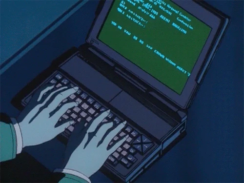

# Oiê, eu sou a Amanda 

### Desenvolvedora Full Stack 🇧🇷

Laravel · JavaScript · TypeScript · React · React Native

  

  

> ✨ *"The world is not in your books and maps, it's out there."* ✨
> — Gandalf, The Hobbit: An Unexpected Journey

  
  

